<h1 align="center">Attractors</h1>

<p align="center">
  <a href="https://angular.dev"></a>
  <a href="https://www.typescriptlang.org"></a>
  <a href="https://registry.khronos.org/webgl/specs/latest/2.0/"></a>
  <a href="https://registry.khronos.org/OpenGL/specs/es/3.0/GLSL_ES_Specification_3.00.pdf"></a>
  <a href="https://github.com/Zambrzyckii/Attractors/actions/workflows/ci.yml"></a>
  <a href="LICENSE"></a>
</p>

<p align="center">
  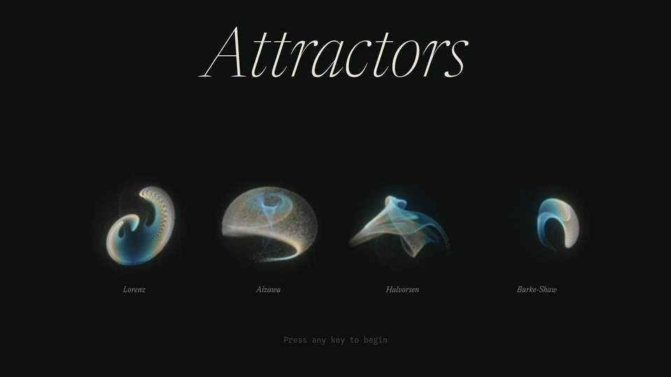
</p>

## Run locally

```bash
npm install
npm start
```

Then open http://localhost:4200/. Needs Node.js 22.22.3+, 24.15+ or 26+ and a browser with WebGL2.

<br>

<p align="center">
  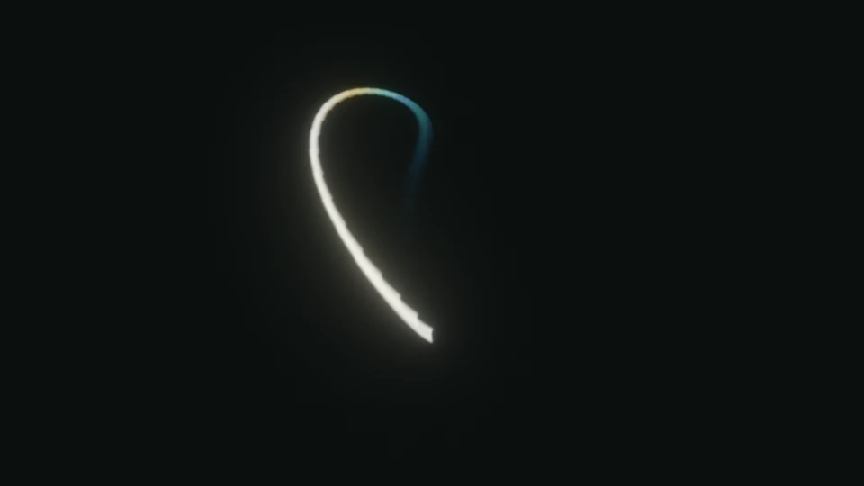
  <br>
  <sub><i>Halvorsen, unfolding from a seed</i></sub>
</p>

<p align="center">
  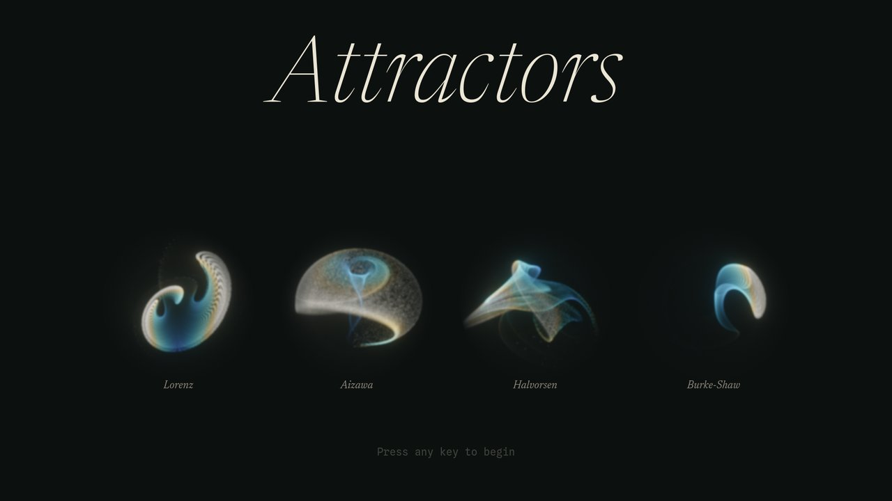
  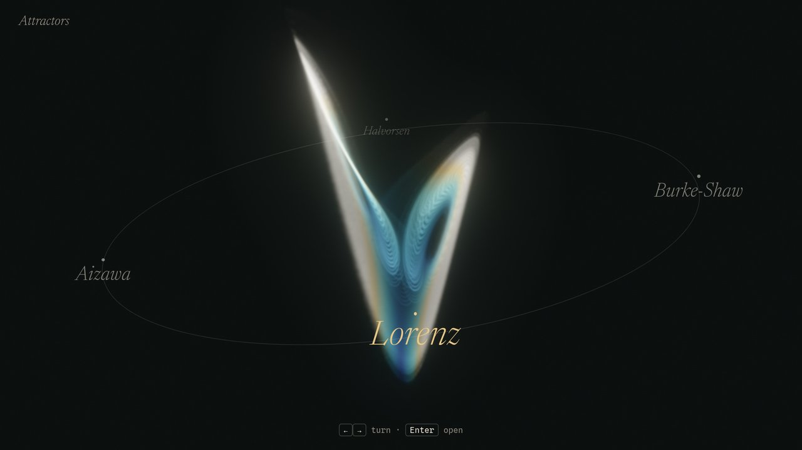
</p>

<p align="center">
  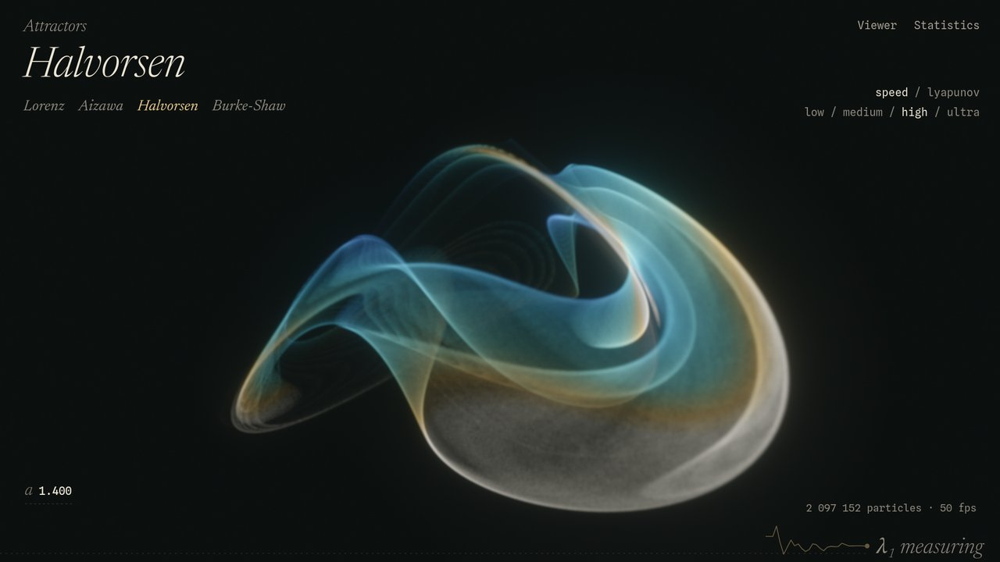
  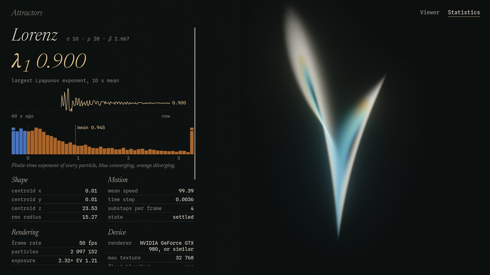
</p>

<p align="center">
  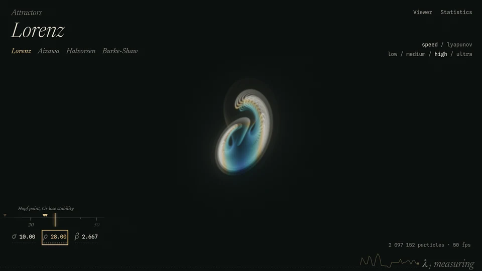
  <br>
  <sub><i>Lorenz, ρ gliding from 28 into the periodic window</i></sub>
</p>

<p align="center">
  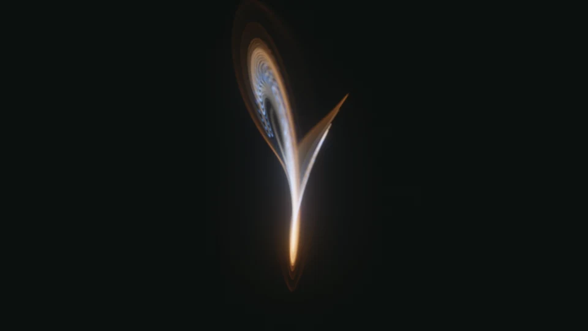
  <br>
  <sub><i>Lorenz in Lyapunov colours</i></sub>
</p>

<p align="center">
  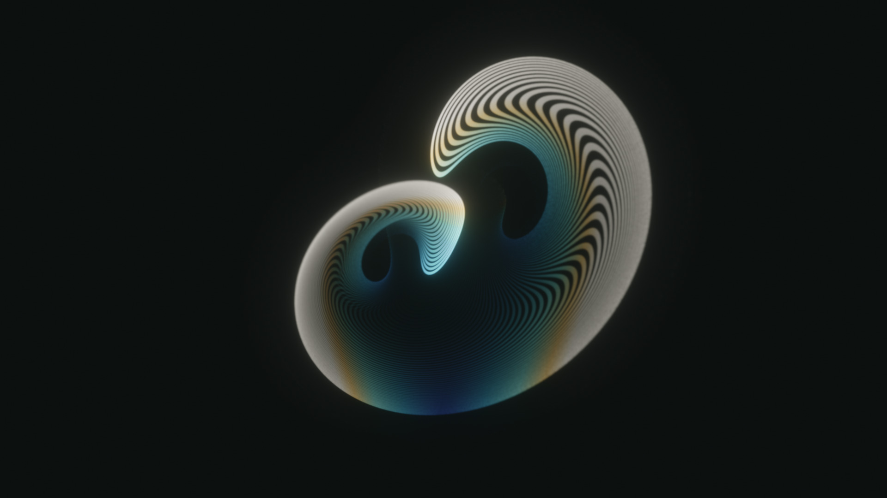
  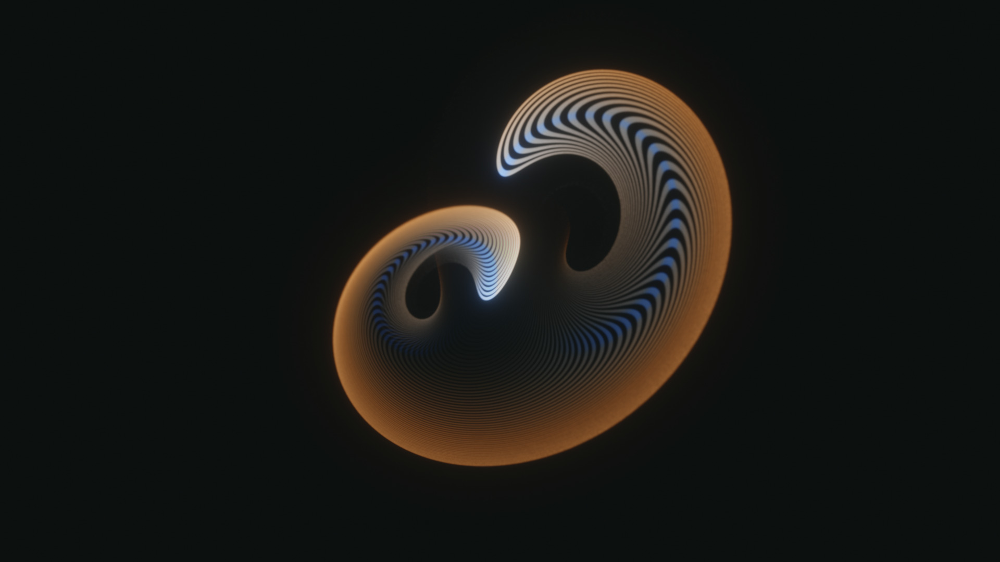
  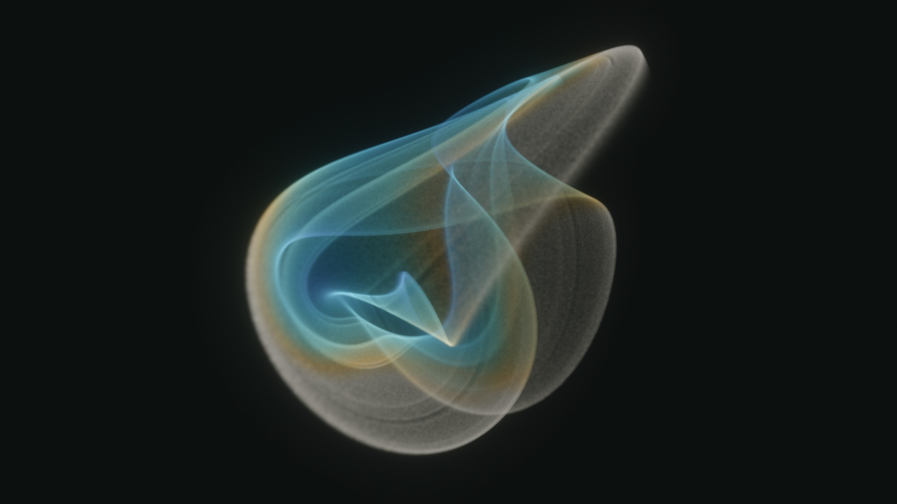
</p>
